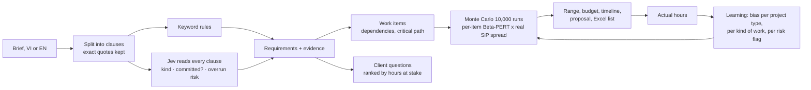

# PARALLAX — The Estimator

**Paste a software delivery brief. See what is being asked (with exact quotes), what the client has not committed to,
the questions to ask, and a draft hour range for a delivery lead to review. Record actual hours from a finished
project; future projects then use that evidence.**

Built for challenge 02 *The Estimator* of Anduin Cybernetics' *Agent in the Shell*.
**Live:** https://the-estimator-9m6a.onrender.com · **Repo:** this one · **Full evaluation record:** [`docs/EVALUATION_LOG.md`](docs/EVALUATION_LOG.md) · **Product readiness review:** [`docs/READINESS_REVIEW.md`](docs/READINESS_REVIEW.md) · **10-minute demo script:** [`docs/DEMO.md`](docs/DEMO.md)

Every number below was measured on data that was **not** used to build or tune what it measures. Labels were committed
before runs (the commits are in the history), and every run is in an append-only journal, including the runs where we
were wrong.

## Results at a glance

| Claim | Tested on (never used to build it) | Result |
| --- | --- | --- |
| Learning from actual hours beats the developers' own estimates | 2,248 real tasks, 2011–2014 (SiP), model fitted on earlier years | MAE **10.34 → 9.26 h (−10.4%)** · SA **48.6 → 54.0%** · Wilcoxon **p = 3×10⁻⁶** · P10–P90 interval holds **82.0%** of actuals |
| …also when replayed as if in production | 1,391 tasks, each estimated using only work *completed* before its estimate date | SA **56.3 → 61.1%** · p = 0.006 versus human estimates. The online update had MAE **3.85 h**, slightly worse than a frozen calibrated model (**3.82 h**); this is not evidence that every update improves accuracy. |
| The "80% range" really holds 80%, for every size of work | same production replay; each finished task adjusts the next ranges (adaptive conformal, step chosen on 2008–2010) | **80.4%** overall (fixed ranges: 85.0%); every size bucket with ≥ 100 tasks within **2.2 points** of 80% (was up to 9.7 off) |
| The AI reader catches scope the client has not committed to | 7 rounds of new brief clauses, 160 clauses (Vietnamese, English, no diacritics, incl. a private-equity onboarding brief), labels committed first | **30/31** caught vs **14/31** with keyword rules · **0** false alarms |
| It finds the main kind of work in each clause | same 160 clauses | **133/160** (rules alone 121/160); private-equity round: Jev alone **13/13** |
| It stops the rules from adding work nobody asked for | rounds 7 and 8, 48 new clauses; threshold fixed on earlier rounds | kind precision **73.1% → 83.3%** and **84.6% → 95.8%**, recall up too |
| It works on the deployed site | a new brief typed into the live app | every clause read by the AI in **1.5 s**, for **$0.0002** |
| Rule fixes generalise | Round 3 written before the fixes; PROMISE_exp: 392 real requirements from projects not used for the fixes | 17/25 → **23/25** · requirements kept 72.7% → **100%** |

SA = standardized accuracy vs random guessing (Shepperd & MacDonell 2012); higher is better. The "human" baseline is
what the company actually used, i.e. its developers' estimates before the work started.

### What did not work, and what we changed

- **"Will this take longer than it looks?"** We had Jev read 798 real SiP tasks.
  - On unseen years, the tasks it flagged overran 1.47× as much as the rest (AUC 0.62).
  - But turning that into extra hours did **not** reduce error.
  - Re-run unchanged and pre-registered on 2,032 Jira issues from 37 other open-source projects (Itemlet), the direction
    held (28.6% of flagged work overran by > 25% vs 19.9% of the rest) but the signal was weak (AUC 0.54), and the
    SiP-based extra hours made error worse (MAE 18.4 → 19.5 h, 95% CI of the change entirely negative).
  - **So the app flags such clauses for senior review and only adds hours once your own actuals show it.**
- **"This person always under-estimates."** Effects per assignee and per project were chosen on 2010 and tested once
  on 2011–2014. They did not beat the size-only model (MAE 9.34 vs 9.26 h), so they were not shipped.
- **Reading an issue and guessing its story points does not beat a model trained for that.** On the
  Choetkiertikul et al. (2019) benchmark (IEEE TSE, doi:10.1109/TSE.2018.2792473; 23,313 issues, 16 projects,
  files from [morakotch/datasets](https://github.com/morakotch/datasets) @ `133a5f5`), Jev scored each issue
  with no story points in the question. Mapping `bins10` had the lowest validation MAE (2.63). For the one
  test, that mapping was refit on train+validation and applied to the authors' test split (4,692 issues).
  Mean test MAE was **2.54**. Table 3 of the authors' preprint gives Deep-SE **2.09** and their median
  baseline **2.77**. A median recomputed on our train+validation rows has MAE **2.56**; those two medians
  are not the same estimator. Jev has a lower MAE than Deep-SE on 4 of 16 projects. There is no paired
  test against Deep-SE: the paper publishes one MAE per project. It is not shipped. GPT2SP is not used as
  a comparison: Tawosi, Moussa and Sarro (IEEE TSE 2023, arXiv:2201.05401) reported an evaluation bug in
  those numbers.
- **Trailing windows, softer buckets, round-number splits, and two other bucket edges.** Eight corrections were
  frozen in `datasets/eval/sip_correction_protocol_v1.json` before any of them was scored (commit `4668353`).
  Fit on 2004–2009, scored on 2010 (557 tasks). A candidate had to beat the shipped size-only model on MAE,
  keep P10–P90 coverage at least 75%, and have a paired bootstrap 95% CI for the MAE gain entirely above 0.
  None did. The lowest point estimate was a round-versus-odd split inside each size bucket: MAE **7.955 h**
  vs **8.189 h**, CI **[−0.202, 0.739]**, Wilcoxon against size-only p = 0.24. Tasks from 2011–2014 were not scored. Not shipped.
- **Keyword rules don't keep up with new phrasing.** Rules tuned through round 4 caught 1/6 uncommitted clauses in round
  5; Jev caught 6/6. This is why the AI reader is mandatory.
- **A costly bug.** The API rewrote our question keys, and 60 paid calls were unusable. The reader now halts the moment
  a paid call returns nothing usable.

## Try it

**Sample briefs** (New project → "No brief yet? Try a sample:") run instantly: their AI readings are cached in the repo.

The app opens in English. **VI** in the header switches the whole interface, including the downloaded quote and the
Excel work list. Questions and work-item names still follow the language of the brief.

**Your own brief:** the AI reader (Jev, by TypeSafe) reads **every** clause before an estimate is produced. If the
server's credits are exhausted you will get a clear message rather than a weaker estimate. Click the **key icon** in the
header and paste your own Jev key ([jevstation.com](https://jevstation.com) or TypeSafe). It is kept in your browser tab,
sent only with requests that read a brief, and never stored on the server.

A 3-minute tour:
1. **New project**: pick *Investor onboarding portal for a private equity fund* and press *Estimate*.
2. **Estimate**: the hour range, the budget at your confidence level and team size, where the hours go, and downloads
   (client proposal in Markdown, work list for Excel).
   Work the client has not committed to is listed separately and does not enter the quote until you confirm it.
3. **Work**: every requirement shows the brief's exact sentence and what the AI read in it. You can edit hours,
   remove items or add your own.
4. **Questions**: questions for the client, ordered by how many hours depend on the answer. Answering creates a new,
   immutable version.
5. **Actual hours**: enter actual hours, in total or per requirement. The next estimates adjust.
6. **Evidence**: all the evidence above, live from the journal.

**Run locally**

```bash
git clone https://github.com/mapleleaflatte03/the-estimator && cd the-estimator
python -m venv .venv && . .venv/bin/activate && pip install -e '.[dev]'
cp .env.example .env          # JEVSTATION_API_KEY, JEVSTATION_API_KEY_2, ... or TYPESAFE_API_KEY
pytest -q                     # offline tests, no network, no credits
uvicorn parallax.main:app --app-dir apps/api --port 8000
cd apps/web && npm ci && npm run dev    # UI on :3000
```

## How it works



- **Reading.** Rules and Jev are combined conservatively:
  - When the rules recognise nothing, Jev's kind is used.
  - When Jev sees a kind the rules missed, the app *asks you* rather than adding hours.
  - Every kind the rules propose is checked by Jev ("does this clause itself ask for it?"); rejected kinds leave the
    estimate and become a question, so nothing disappears silently.
  - A kind the rules missed is added directly only when Jev is ≥ 95% confident (you can remove it; removals are
    learned).
  - A clause is uncommitted if either reader says so; the Jev threshold of 0.7 was fixed before any test.
- **Jev client** (`apps/api/parallax/jev.py`):
  - A pool of any number of keys, with automatic failover on empty keys.
  - Questions are packed 5 per call (JevStation bills 1 credit for ≤ 5 questions).
  - Calls run in parallel.
  - Every answer is cached per question version and clause, so re-estimates are free and consistent.
  - The model is pinned to `jev-1.13.0` because every threshold was measured on it.
  - A circuit breaker stops spending if a paid call returns nothing usable.
- **Estimating** (`estimation/engine.py`):
  - Three-point estimates per work item, simulated 10,000 times.
  - The shared "everything ran over" shock is resampled from 56 real SiP work packages, not assumed.
  - The critical path limits how much adding people can shorten the timeline.
- **Learning** (`service.py`, `risk.py`, `conformal.py`):
  - A bias multiplier learned from finished projects, per project type, partially pooled.
  - The width of the "80% range" self-corrects: every finished project that lands outside widens the next ranges,
    every hit narrows them.
  - Optional per-requirement actuals teach per-kind factors (e.g. "our reporting work runs 30% over") and the weight of
    the AI's risk flag. Both start at 1.0 and move with evidence; your manual edits always win.
- **Versions** are immutable. Answers to questions and edits accumulate. Accuracy is always judged against the estimate
  that was committed.

## Reproduce every number

| Result | Command | Credits |
| --- | --- | --- |
| SiP holdout, SA, Wilcoxon | `POST /api/v1/benchmark/run` or Evidence tab → *Chạy kiểm tra* | 0 |
| Production replay | `python scripts/sip_operational_replay.py` | 0 |
| Honest ranges (adaptive conformal) | `python scripts/sip_conformal_replay.py select` then `test` | 0 |
| Person/project effects (negative) | `python scripts/sip_model_search.py search` then `test` | 0 |
| Reader rounds 1–6 | `python scripts/evaluate_readers.py --labels datasets/eval/clause_labels_v5.json --tag x` | 0 (cached) |
| PROMISE_exp | `python scripts/evaluate_promise.py --tag x` | 0 |
| Jev on SiP tasks | `python scripts/sip_jev_study.py report` | 0 (cached) |
| Itemlet replication | `python scripts/itemlet_jev_replication.py report` | 0 for what is cached |
| Journal → log table | `python scripts/journal_report.py` | 0 |

The Itemlet report reads a Parquet file and needs the optional evaluation packages:
`pip install -e '.[eval]'`. Its downloaded input belongs in `datasets/external/itemlet/`.

## Data

| Dataset | What | License | How it is used |
| --- | --- | --- | --- |
| [SiP](https://github.com/Derek-Jones/SiP_dataset) (Jones & Cullum 2019) | 10,022 real tasks with estimated and actual hours, 2004–2014 | CC BY-NC-ND 4.0 | Calibration, uncertainty, benchmarks. Files unmodified; we store only task ids and Jev's probabilities, never the text |
| [Itemlet](https://doi.org/10.5281/zenodo.19411554) (Abebe & Rusiecki 2026) | Jira issues with logged hours and original estimates | CC BY 4.0 | Independent replication (downloaded on demand, not committed) |
| [PROMISE_exp](https://doi.org/10.1145/3350768.3350776) (Lima et al. 2019) | 969 real requirements | research | Rule checks |
| Clause sets v1–v8 | 187 brief clauses written in the style of client briefs, hand-labelled before runs | this repo | Reader evaluation |

The AI provider is interchangeable: the same pinned model (`jev-1.13.0`) was used through JevStation (credits) and
TypeSafe directly (about $0.04 per million input tokens: the whole Itemlet replication cost a few cents).

## Limitations

1. Hour templates per kind of work are engine assumptions. Per-requirement actuals correct them over time, but only your
   own outcomes can validate them. The SiP task benchmark tests correction of an existing human estimate, **not** the
   full brief-to-hours pipeline. No measured end-to-end accuracy is claimed for this app's generated quotes.
2. SiP is one UK company's maintenance work. It is the only public source with task text, estimate and actual together;
   its error distribution may not transfer (Itemlet shows how much it can differ). SiP's licence is non-commercial: a
   commercial version needs permission or another data source.
3. The labelled clause sets were written by the developer, not taken from real client documents.
4. JevStation is an independent reseller: brief text passes through it. Use TypeSafe directly for confidential work.
5. Each browser gets an anonymous workspace: its projects, actual hours and learned adjustments are separate from other visitors. The free hosting plan has no persistent disk, so projects reset when the service restarts. The browser keeps the last brief, answers and actual hours, and can ask Jev to read that brief again.

## Roadmap

From our research report ([`reports/`](reports/)):
- **Conformal ranges per kind of work** (today they adapt per project and, in the validation, per size).
- **Retrieval of similar finished tasks** as the outside view and as examples for the AI.
- **Import actuals** from Jira, Toggl or Harvest, with stable task ids.
- **A pilot with a Vietnamese software outsourcing company.**
